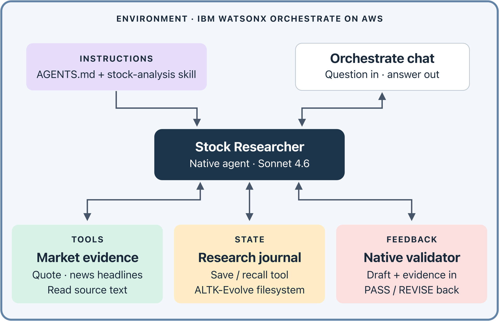

# Stock Researcher on IBM watsonx Orchestrate

A native researcher answers stock questions using Yahoo Finance data, keeps a per-user research journal, and delegates full-report review to a second native agent. The same chat supports a quick quote, a longer research report, and recall of previous work.



## How the harness fits together

| Component | Files | Role |
| --- | --- | --- |
| Instructions | [AGENTS.md](AGENTS.md), [stock-analysis skill](skills/stock-analysis/SKILL.md) | Standing rules cover quotes, sources, and memory. The skill describes the workflow for reports. Both texts are included in the researcher's YAML at import. |
| Tools | [quote.py](tools/quote.py), [news.py](tools/news.py) | Fetch a regular-session quote, discover headlines for a ticker, and read supported Yahoo Finance article pages. Unavailable article text is flagged. |
| Environment | [researcher.yaml](researcher.yaml) | Orchestrate hosts the researcher, configures its model and tools, supplies caller identity, and exposes its validator collaborator. |
| State | [journal.py](tools/memory/journal.py), [memory dependencies](tools/memory/requirements.txt) | The researcher recalls earlier work and saves dated activity, insights, and report text. |
| Feedback | [validator.yaml](validator.yaml) | The researcher sends the question, draft, and evidence to the validator. The validator checks support for material claims and returns PASS or specific corrections. |

## Import into your own environment

Use the watsonx Orchestrate ADK CLI with an authenticated environment where you can import Python tools and native agents. Run these commands from this folder. Check the active target first. The example uses the Bedrock Claude Sonnet 4.6 model route in both YAML files. If your environment offers different models, set each file's `llm` field to a route available there.

```sh
orchestrate env list
orchestrate tools import -k python -f tools/quote.py -r tools/requirements.txt
orchestrate tools import -k python -f tools/news.py -r tools/requirements.txt
orchestrate tools import -k python -f tools/memory/journal.py -r tools/memory/requirements.txt
orchestrate agents import -f validator.yaml
orchestrate agents import -f researcher.yaml
```

The news module registers two tools. Importing the validator before the researcher makes the named collaborator available. Open **Stock Researcher With Harness** in Draft Preview to try the prompts below. After changing either instruction file, refresh the literal instructions block in `researcher.yaml` before importing it again.

## Research memory

The journal tool uses [ALTK-Evolve](https://github.com/AgentToolkit/altk-evolve) with its filesystem backend. It writes to a runtime-local `stock-research-evolve/` directory beside the tool. Orchestrate supplies the user and tenant context at runtime. The tool derives a namespace from that context and the researcher name, and requires a caller identity.

A save records the ticker, timestamp, and supplied text as an activity, note, or report. Recall can filter by ticker or return a recap across tickers. A saved thesis gives the next conversation a starting point. The quote tool supplies fresh prices.

## Demo

These screenshots capture example output from an earlier run. Market values in them are historical.

1. **Quote.** Ask “Talk to me about Ford. What's it trading at?” The answer pairs a price with the currency, market timestamp, and source. [View the quote](demo/ford-quote.png).
2. **Full report.** Follow up with “Run a full report on this.” The skill calls for gathering evidence, drafting the report, and sending it to the validator before delivery. The captured response marks the report saved and reviewed. [View the report](demo/ford-report.png).
3. **Research history.** Ask “What stocks have we talked about?” The journal's recall action accepts an empty ticker filter to summarize earlier work. A new installation starts with its own journal. [View the history](demo/research-history.png).
